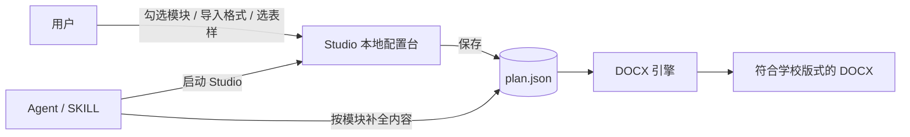

# 活动方案工坊 · Activity Plan Builder

> 面向中国高校大型活动的交互式方案生成器：先在浏览器里选模块、套学校格式、挑表格样式，再让 Agent 补全内容，一键导出规范 DOCX。


适用场景：元旦晚会、草地音乐节、国庆升国旗、迎新活动、运动会、社团活动、讲座论坛、志愿服务等。

---

## 解决什么问题

直接用 AI 生成活动方案，常见问题是：结构不受控、格式不符合学校要求、表格不能改、生成完还要从头排版。

这个项目把流程拆成三步：

1. **用户先做选择** —— 在本地 Studio 勾选需要的章节、导入学校字体格式、挑选表格样式；
2. **Agent 再补内容** —— 只补用户允许补全的模块，不擅自改结构、不编造人名与金额；
3. **引擎最后排版** —— 按选定版式输出 DOCX，标题、行距、缩进、页码、表头底纹、合计行全部落地。

## 能做什么

- **交互式五步配置台（Studio）**：基本信息 → 模块编排 → 版式规范 → 表格样式 → 内容与导出，右侧 A4 实时预览，所见即所得
- **26 个章节模块**：核心 / 推荐 / 进阶三级，可勾选、排序，可标记哪些章节交给 Agent 补全
- **一键导入学校格式**：拖入学校 DOCX 模板，或粘贴一段文字规范，自动识别字体、字号、行距、缩进、页边距、表头样式
- **表格样式与开关**：5 套结构型表格样式（三线表、时间轴、预算表等），也可一键关闭全部表格、只出纯文字版
- **规范 DOCX 输出**：小标宋标题、黑体一级标题、仿宋正文、固定行距、首行缩进、页码、合并单元格、附件另起一页
- **跨 Agent 通用**：既可作为技能（SKILL.md）装进 TRAE 等支持技能的 Agent，也可作为 MCP 服务接入 Claude Desktop、Cursor 等任意 MCP 客户端

## 工作原理



用户的全部选择（模块、顺序、版式、表格样式、已写好的内容）都会保存为一个可读的 `plan.json`；Agent 只在这个文件上补全内容，最后由排版引擎生成 DOCX。人和 Agent 各管一段，互不覆盖。

---

## 安装（推荐：交给 Agent）

整个技能包只有代码和资产，不依赖你的系统配置。**最简单的安装方式是让目标 Agent 自己装**：

1. 把压缩包发给目标 Agent；
2. 同时发送下面这句话：

```text
请阅读压缩包内的 AGENT_INSTALL_PROMPT.md 并按其中的步骤完成安装；需要了解工作方式时阅读 SKILL.md。安装前先询问我选择全局安装还是仅本会话安装，完成后报告安装方式、路径与验证结果。
```

Agent 只需阅读 `AGENT_INSTALL_PROMPT.md`（安装步骤）和 `SKILL.md`（工作方式）即可自主完成安装，无需你动手。提示词的完整内容见 [AGENT_INSTALL_PROMPT.md](AGENT_INSTALL_PROMPT.md)，也可以直接把该文件的整段内容粘给 Agent。

### 手动安装（备选）

- 环境要求：Python 3.10+，`python -m pip install -r requirements.txt`
- 作为技能：把整个 `activity-plan-builder` 文件夹放入技能目录（TRAE 为 `~/.trae-cn/skills/activity-plan-builder`，其他 Agent 按其技能目录规则）
- 作为 MCP：把 `mcp/server.py` 注册为 MCP 服务，配置模板见 [`mcp/config-examples/`](mcp/config-examples/)（Claude Desktop / Cursor / TRAE 各一份，需把路径改成实际解压路径）

## 使用

装好后，在任意支持的 Agent 里直接说：

> 帮我写一个联合研究生院元旦晚会活动方案，套用学校的 Word 格式。

Agent 会打开 Studio，你按五步操作：

| 步骤 | 你要做什么 |
| --- | --- |
| 1 基本信息 | 填活动名称、日期、时间、地点、主办承办 |
| 2 模块编排 | 勾选需要的章节（背景、预算、安全预案……）并排序 |
| 3 版式规范 | 选预设，或拖入学校模板 / 粘贴文字格式要求 |
| 4 表格样式 | 选表格样式，或关闭全部表格 |
| 5 内容与导出 | 自己改内容，或点“交给 Agent”让 Agent 补全，生成 DOCX |

Studio 也可以脱离 Agent 单独使用：直接在浏览器里点“生成 DOCX”即可，无需回到命令行。

## 升级更新

新版本以 zip 发布。用户可以用一条命令更新（自动备份旧版、不影响已有方案）：

```bash
python "<技能目录>/scripts/apb.py" update --url <新版本 zip 地址>
```

也可以直接在对话里让 Agent 更新（Agent 会调用 MCP 的 `update` 工具）。详见发布方的 Release 说明。

## 兼容性与字体

- Windows / macOS / Linux 均可运行；Studio 只在本机 `127.0.0.1` 上运行，不上传任何数据
- DOCX 中的中文字体依赖本机安装情况；未安装“方正小标宋简体”“仿宋_GB2312”等字体时 Word 会自动回退显示，但字号、行距、缩进、页边距等排版参数仍然保留

## 已知限制

- 学校格式识别是启发式的，复杂模板可能只识别部分字段，可在 Studio 第 3 步手动微调
- 页数为估算值，最终以 Word 实际分页为准
- 暂不导出 PDF；可先生成 DOCX，再用 Word / WPS 另存为 PDF

## 文件构成

| 文件 | 面向谁 | 内容 |
| --- | --- | --- |
| `README.md` | 用户 | 本文件：项目介绍、安装与使用 |
| `AGENT_INSTALL_PROMPT.md` | Agent | 自主安装步骤（转发给 Agent 用） |
| `SKILL.md` | Agent | 技能工作流、命令与写作规则 |
| `mcp/server.py` | MCP 客户端 | 零依赖 MCP 服务入口 |
| `examples/` | 用户 | 示例方案：[demo.plan.json](examples/demo.plan.json) · [demo.docx](examples/demo.docx) |

## License

MIT
